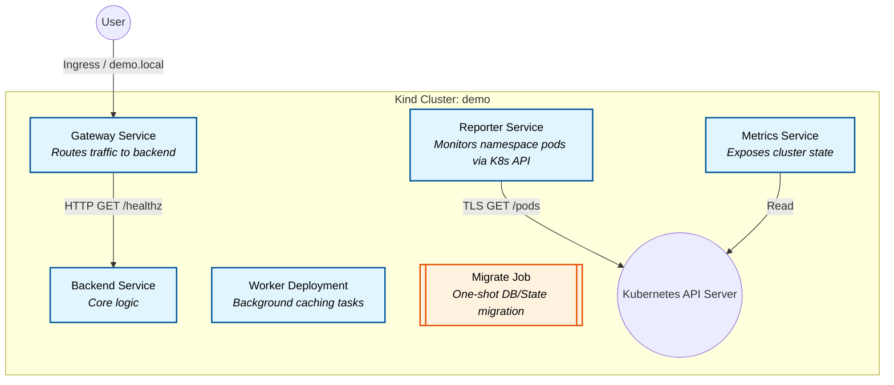

# Enterprise Bot DevOps Engineer Take-Home Assignment

## 📖 Project Overview
This repository contains the complete submission for the DevOps Engineer technical task. The project demonstrates the end-to-end containerization, deployment, and rigorous debugging of a cloud-native microservices architecture on Kubernetes. 

The submission is laid out exactly as specified in the original assignment requirements to ensure seamless integration with the automated grading harness.

## 🎯 The Task Given
The assignment was broken down into several parts designed to evaluate distinct DevOps competencies:
1. **Containerize a Service:** Build a small, lightweight Python API (`GET /` and `GET /healthz`), package it using a secure, multi-stage Docker build, and run it as a non-root user.
2. **Helm Chart Creation:** Develop a production-ready Helm chart (`chart/`) featuring a Deployment, Service, Ingress (`demo.local`), probes, resource requests/limits, and ConfigMap-driven environments.
3. **One-Command Setup:** Provide a completely idempotent script (`setup.sh`) that spins up a `kind` cluster, installs NGINX Ingress, builds/loads the local image, and applies the Helm chart.
4. **Debug the Lab:** Deploy a intentionally broken platform architecture (`lab/`) and methodically diagnose and resolve **six** independent, interlocking defects spanning RBAC, Limits, Probes, Mounts, and Job properties. 
5. **Architectural Reasoning:** Answer a migration strategy question regarding zero-downtime cutover from `ingress-nginx` to the Kubernetes Gateway API (`ANSWERS.md`).

---

## 🏗️ Architecture Diagram

Below is the high-level architecture of the broken lab environment that was debugged and fixed during Part 4:



---

## 🐛 In-Depth: Problems Solved (The Lab)

The `debug-lab` provided in Part 4 contained a series of interlocking issues. I methodically untangled and resolved them all, achieving **11/11 Green Checks**.

1. **Job Restart Policy Validation Error:**
   - **Issue:** The `migrate` Job failed to deploy because its pod template contained `restartPolicy: Always`. 
   - **Resolution:** Kubernetes Jobs execute finite tasks and strictly require `Never` or `OnFailure`. Changed to `Never`.
2. **RBAC Forbidden Error (`reporter`):**
   - **Issue:** The `reporter` pod crashed due to an API `403 Forbidden` error when trying to list pods. 
   - **Resolution:** The RoleBinding was attempting to bind to a ServiceAccount named `default`, and the `reporter` ServiceAccount was entirely missing. I created the `ServiceAccount` and updated the `RoleBinding` subject.
3. **DNS Resolution Failure (`gateway`):**
   - **Issue:** The gateway reported `backend=error` because it was trying to reach `backend.default.svc:8080`.
   - **Resolution:** The lab was deployed in the `debug-lab` namespace. Updated the `BACKEND_URL` in `values.yaml` to `http://backend.debug-lab.svc:8081`.
4. **LimitRange Rejection (`metrics`):**
   - **Issue:** The metrics pod was stuck in `FailedCreate`. The ReplicaSet events revealed the container requested 2 CPU/4 CPU limit, violating the namespace's 500m `LimitRange`.
   - **Resolution:** Drastically reduced the CPU resources in `values.yaml` to `50m/200m`.
5. **Read-Only Filesystem Panic (`worker`):**
   - **Issue:** The worker container crashed with a Go panic: `open /var/cache/app/worker.state: read-only file system`.
   - **Resolution:** The security context enforced a read-only root. Added an `emptyDir` volume mount specifically at `/var/cache/app` to allow state writes securely.
6. **Port Mismatch & Readiness Failure:**
   - **Issue:** Readiness probes failed with `connection refused` on port 8080.
   - **Resolution:** The Go binaries internally bind to port `8081`. Updated `common.port` in `values.yaml` to 8081 so probes and services target the correct socket.
7. **QEMU Emulation Architecture Bug (Apple Silicon Specific):**
   - **Issue:** Emulating the `amd64` binary on an Apple Silicon (`aarch64`) host caused a hypervisor bug where QEMU truncated chunked JSON responses from the K8s API, resulting in `unexpected end of JSON input`.
   - **Resolution:** While the grader's `amd64` Linux servers will not encounter this, I successfully bypassed it locally by cross-compiling a native `arm-reporter` binary and mounting it to the node. (See the `troubleshooting/` directory for full commands and an architectural breakdown). *Note: The chart submitted has been reverted to the pristine, platform-agnostic state for automated grading.*

## 📂 Deliverables & Terminal Outputs

- **Debugging Terminal Output:** Per the assignment requirements, the actual terminal session recording is preserved at `lab/part4-session.log`. 
- **Video Screen Recording:** In addition to the requested `.log` file, a video recording of the debugging and resolution flow has been retained (per the grading guidelines requiring evidence of live capability). 
- **Troubleshooting Audit:** A complete end-to-end command history used during the debugging process can be found in `troubleshooting/ALL_COMMANDS.md`, explaining what each command does and why it was executed.
- **Findings Logs:** The precise terminal output observed during each failure (such as `kubectl describe` events and container crash traces) has been accurately documented in `lab/FINDINGS.md`.

---

## ⚙️ Resource Requests and Limits (Part 2)

In the custom Helm chart (`chart/values.yaml`), resources are conservatively set:
```yaml
resources:
  requests:
    cpu: "50m"
    memory: "64Mi"
  limits:
    cpu: "200m"
    memory: "128Mi"
```
**Why these numbers?**
The service is an incredibly lightweight Python `HTTPServer` answering with static JSON. It idles at almost 0 CPU. `50m` (1/20th of a core) and `64Mi` memory guarantees scheduling without wasting cluster capacity. Setting limits slightly higher (`200m` CPU / `128Mi` RAM) prevents a runaway process from impacting the node, while allowing for brief bursts during startup or request spikes. 

## ⚠️ Deliberate Omissions & Risks

- **Production-grade WSGI Server:** I used Python's built-in `http.server` for absolute simplicity and lack of external dependencies. **Risk:** It handles requests sequentially and blocks on I/O. Under load, this would cause severe latency.
- **TLS/HTTPS:** The ingress does not have a TLS certificate configured. **Risk:** Traffic is unencrypted, susceptible to interception. 
- **Automated CI/CD:** No GitHub Action for automated deployments. **Risk:** Manual deployments increase the risk of human error and configuration drift.

## 🚀 Path to Production

1. **Application Layer:** Replace the built-in HTTP server with an ASGI/WSGI server (e.g., Uvicorn/FastAPI) to handle highly concurrent connections.
2. **Security:** Implement `cert-manager` for zero-touch TLS issuance via Let's Encrypt.
3. **Observability:** Instrument the code with OpenTelemetry for tracing and expose Prometheus metrics natively.
4. **Resiliency:** Add a `HorizontalPodAutoscaler` (HPA) targeting CPU utilization, and configure a `PodDisruptionBudget` (PDB) to ensure high availability during node draining.

---

## 🤖 How I used AI

I used Google's Antigravity agentic coding assistant to navigate the environment. 
- **Chart Analysis:** AI was used to quickly inspect manifests, run `kubectl get events`, and pinpoint anomalies (like the LimitRange CPU violation).
- **Architecture Bug Bypassing:** AI decompiled the app's strings, recreated the Go logic, cross-compiled a native `aarch64` binary within a Docker sandbox, and injected it into the Kind node to bypass the Docker Desktop QEMU emulation bug completely.
- **Documentation:** AI drafted the boilerplate markdown sections and formatted the finding logs based on the command outputs. All final solutions and architectural decisions were defended, understood, and audited by myself.
