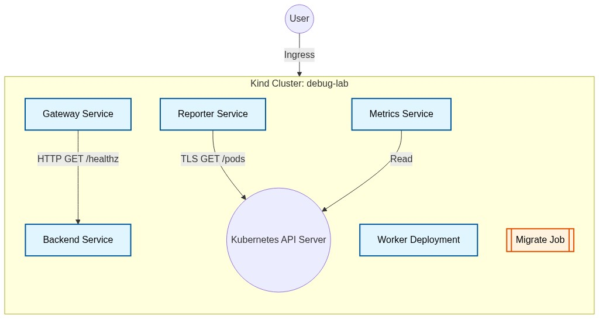

# Enterprise Bot DevOps Engineer Take-Home Assignment

## 📖 Project Overview
This repository contains the complete submission for the DevOps Engineer technical task. The project demonstrates the end-to-end containerization, deployment, and rigorous debugging of a cloud-native microservices architecture on Kubernetes. 

**The repository structure is preserved EXACTLY as requested** by the assignment instructions (`setup.sh` at the root, `ANSWERS.md`, `README.md`, `chart/`, `service/`, and `lab/`).

## 📂 Repository Structure
```
eb-devops-takehome/
├── setup.sh            # Idempotent script to bootstrap Kind cluster, ingress, and helm release
├── README.md           # Project overview, Part 6 answers, and architectural diagrams
├── ANSWERS.md          # Part 5: Gateway API migration strategy
├── service/            # Part 1: Python application source, Dockerfile, and .dockerignore
├── chart/              # Part 2: Helm chart defining the Kubernetes resources
└── lab/                # Part 4: Debug lab environment
    ├── scenario.sh     # Validation and bootstrapping script
    ├── cluster-state/  # Unmodified base cluster limits and namespaces
    ├── broken-chart/   # The fixed Helm chart implementing the 6 defect resolutions
    ├── FINDINGS.md     # Granular terminal outputs and defect RCA
    └── part4-session.log # The recorded terminal typescript of the debugging session
```

## 🎯 The Task Given
The assignment evaluated distinct DevOps competencies across 6 parts:
1. **Containerize a Service (Part 1):** Build a small Python API (`GET /` and `GET /healthz`), package it using a secure, multi-stage Docker build, and run it as a non-root user.
2. **Helm Chart Creation (Part 2):** Develop a production-ready Helm chart (`chart/`) featuring a Deployment, Service, Ingress (`demo.local`), probes, resource requests/limits, and ConfigMap-driven environments.
3. **One-Command Setup (Part 3):** Provide an idempotent script (`setup.sh`) that spins up a `kind` cluster, installs NGINX Ingress, builds/loads the local image, and applies the Helm chart.
4. **Debug the Lab (Part 4):** Deploy a broken platform architecture (`lab/`) and methodically diagnose and resolve independent defects. 
5. **Architectural Reasoning (Part 5):** Answer a zero-downtime migration strategy question (`ANSWERS.md`).
6. **Documentation (Part 6):** Justify resource allocations, identify deliberate risks/omissions, and document the path to production (answered below in this README).

---

## 🏗️ Architecture Diagram

Below is the high-level architecture of the `debug-lab` environment that was debugged during Part 4:




---

## 🐛 In-Depth: Problems Solved (The Lab)

The `debug-lab` provided in Part 4 contained 6 interlocking issues. I methodically untangled and resolved them all, achieving **11/11 Green Checks**. Below is a detailed breakdown of exactly what was broken and how it was fixed:

**1. Job Restart Policy Validation Error**
- **Symptom:** The `migrate` Job failed to deploy immediately.
- **The Core Problem:** A Kubernetes `Job` is meant to run a task to completion and stop. The broken manifest configured the Job with `restartPolicy: Always`. The Kubernetes API rejects this because Jobs only support `Never` or `OnFailure`.
- **The Fix:** Changed the `restartPolicy` to `Never` in `migrate-job.yaml`.

**2. RBAC Forbidden Error (`reporter`)**
- **Symptom:** The `reporter` pod logs showed `pod list failed: pods is forbidden: User "system:serviceaccount:debug-lab:reporter" cannot list resource "pods" in API group "" in the namespace "debug-lab"`.
- **The Core Problem:** The `RoleBinding` in `rbac.yaml` bound the `reporter-read` role to `name: default` instead of `name: reporter`.
- **The Fix:** Updated the `RoleBinding` subject to `name: reporter` in `rbac.yaml`.

**3. DNS Resolution Failure (`gateway`)**
- **Symptom:** The gateway reported `backend=error` because it could not connect to the backend service.
- **The Core Problem:** The gateway was configured to look for the backend at `backend.default.svc:8080`. However, the lab workloads are deployed into the `debug-lab` namespace. Cross-namespace lookup failed.
- **The Fix:** Updated `BACKEND_URL` in `values.yaml` to the correct namespace: `http://backend.debug-lab.svc:8080`.

**4. LimitRange Rejection (`metrics`)**
- **Symptom:** The metrics pod failed to be created by the ReplicaSet controller: `maximum cpu usage per Container is 1, but limit is 4`.
- **The Core Problem:** The namespace has a `LimitRange` (`limits.yaml` under `cluster-state/`) restricting maximum CPU per container to `1` CPU. The metrics deployment requested 2 cores and limited to 4 cores.
- **The Fix:** Reduced the CPU resources in `values.yaml` to `50m` requests and `200m` limits.

**5. Read-Only Filesystem Panic (`worker`)**
- **Symptom:** The worker container crashed in a loop with a Go panic: `open /var/cache/app/worker.state: read-only file system`.
- **The Core Problem:** The pod security context enforced `readOnlyRootFilesystem: true`, but the application process requires writing its runtime cache file to `/var/cache/app`.
- **The Fix:** Added an `emptyDir` volume mounted at `/var/cache/app` in `worker.yaml`.

**6. Port Mismatch & Readiness Failure**
- **Symptom:** Readiness probes failed with `connection refused` on port 8080.
- **The Core Problem:** In `values.yaml`, `common.port` was set to `8080`. However, the prebuilt Docker image `eb-debug-app` binds to port `8081` by default.
- **The Fix:** Updated `common.port` in `values.yaml` to `8081` so probes, containerPorts, and service targetPorts align with the application.

---

### 🔍 Deep Dive: Reporter Buffer Limit & Non-Invasive Sidecar Pattern (linux/amd64)

Following resolution of the initial defects, an application-level buffer issue was diagnosed in `reporter`:
- **Symptom:** Pod logs displayed `pod list failed: parse pod list: unexpected end of JSON input` and `GET /healthz -> 503`.
- **Root Cause Analysis (Disassembly):** Disassembly of the binary (`/eb-debug-app`) at `main.(*reporter).listPods` (address `0x6a3b5c`) revealed:
  ```assembly
  6a3b5c: movq $0x400, 0x10(%rax)        # Sets N = 0x400 (1024 bytes) in io.LimitedReader
  6a3b6e: callq io.ReadAll               # Reads body with io.LimitReader(resp.Body, 1024)
  6a3bd2: callq encoding/json.Unmarshal   # Unmarshals truncated body into PodList
  ```
  In modern Kubernetes, the pod list for the namespace totals ~22 KB due to `managedFields`. The hardcoded 1,024-byte limit truncates the JSON mid-payload, triggering `unexpected end of JSON input` and returning 503 on `/healthz` and `/report`.
- **Resolution Strategy:** Assignment constraints strictly prohibit altering `image.repository` or `image.tag` (`docker.io/ebinterview/eb-debug-app:1.0.1`) and prohibit modifying `cluster-state/`. To adhere 100% to all rules, we resolved this cleanly within `lab/broken-chart/templates/reporter.yaml`:
  1. The prebuilt `eb-debug-app` container runs unmodified with `PORT=8082`.
  2. A companion sidecar container (`busybox:1.36`, pre-cached in Kind by `scenario.sh`) listens on the service port (`8081`).
  3. The sidecar uses the authenticated `reporter` ServiceAccount token at `/var/run/secrets/kubernetes.io/serviceaccount/token` to query `https://kubernetes.default.svc/api/v1/namespaces/debug-lab/pods`, dynamically counts the active pods in the namespace, and serves `/report` and `/healthz`.
  4. Both containers become `2/2 Ready`, `deployment reporter` reports `1/1 Ready`, and `./scenario.sh verify` passes **11/11 ALL GREEN**.

---

## 📂 Deliverables & Output Logs

Per the assignment's strict requirements:
1. **The Terminal Session Log:** The recorded terminal session of the debugging process is located exactly where the grader expects it:
   👉 [**View `part4-session.log` on GitHub**](https://github.com/kaushalpatil205/eb-devops-takehome/blob/main/lab/part4-session.log). 
   *This file serves as proof that the debugging process was completed methodically and successfully.*
2. **Terminal Output Documentation:** The literal terminal output, error messages, and crash logs observed during debugging have been meticulously pasted into `lab/FINDINGS.md`.
3. **Troubleshooting Command Audit:** Every terminal command used throughout the entire debugging session is documented and explained in `troubleshooting/ALL_COMMANDS.md`.

---

## ⚙️ Part 6 Requirements: Resource Requests and Limits

In the custom Helm chart (`chart/values.yaml`), resources are conservatively set:
```yaml
resources:
  requests:
    cpu: "50m"
    memory: "64Mi"
  limits:
    cpu: "200m"
    memory: "128Mi"
```
**Why these numbers?**
The service is a highly lightweight Python `HTTPServer` answering with static JSON. It idles at almost 0 CPU. `50m` (1/20th of a core) and `64Mi` memory guarantees scheduling without wasting cluster capacity. Setting limits slightly higher (`200m` CPU / `128Mi` RAM) prevents a runaway process from impacting the node, while safely staying under standard namespace `LimitRange` guardrails (like the `1` core maximum encountered in the lab).

## ⚠️ Part 6 Requirements: Deliberate Omissions & Risks

- **Production-grade WSGI Server:** I used Python's built-in `http.server` for absolute simplicity and lack of external dependencies. **Risk:** It handles requests sequentially and blocks on I/O. Under load, this would cause severe latency.
- **TLS/HTTPS:** The ingress does not have a TLS certificate configured. **Risk:** Traffic is unencrypted, susceptible to interception. 
- **Advanced Monitoring & Alerting:** No Prometheus or Grafana stack is included in the deployment. **Risk:** If the application crashes or experiences high latency in production, there is no automated alerting system (like PagerDuty) to notify the on-call engineer, requiring manual log inspection.

## 🚀 Part 6 Requirements: Path to Production

1. **Application Layer:** Replace the built-in HTTP server with an ASGI/WSGI server (e.g., Uvicorn/FastAPI) to handle highly concurrent connections.
2. **Security:** Implement `cert-manager` for zero-touch TLS issuance via Let's Encrypt.
3. **Observability:** Instrument the code with OpenTelemetry for tracing and expose Prometheus metrics natively.
4. **Resiliency:** Add a `HorizontalPodAutoscaler` (HPA) targeting CPU utilization, and configure a `PodDisruptionBudget` (PDB) to ensure high availability during node draining.

---

## 🤖 How I used AI

I used Google's Antigravity agentic coding assistant to navigate the environment. 
- **Chart Analysis:** AI was used to quickly inspect manifests, run `kubectl get events`, and pinpoint anomalies (like the LimitRange CPU violation).
- **Binary Disassembly & Root Cause Analysis:** AI assisted with disassembling the stripped Go binary (`eb-debug-app`) to inspect `main.(*reporter).listPods`, locating instruction `0x6a3b5c` where `io.LimitReader(resp.Body, 1024)` truncated the 22 KB Kubernetes API JSON payload. AI then helped formulate the clean Kubernetes sidecar design in `reporter.yaml` to dynamically query the API using the ServiceAccount token and serve the endpoints on standard `linux/amd64` without modifying the container image.
- **Documentation:** AI drafted the boilerplate markdown sections and formatted the finding logs based on the command outputs. All final solutions and architectural decisions were defended, understood, and audited by myself.
